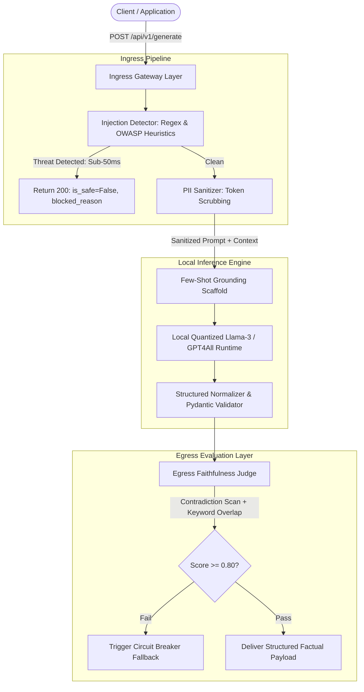

# Enterprise LLM Guardrail & Automated Evaluation Gateway

A high-reliability, local-first LLM inference proxy and security gateway engineered to enforce deterministic type-safety, ingress security sanitization, and real-time egress factual grounding on quantized open-source models without third-party API dependencies or recurring cloud costs.

---

## 🎯 Architecture Overview

Enterprise deployments of Large Language Models frequently suffer from three critical production vulnerabilities:
1. **Security & Compliance Leaks:** Unsanitized PII and adversarial prompt injections directly reaching inference buffers.
2. **Schema Instability:** Quantized local models (3B/8B) drifting from strict JSON API contracts and emitting conversational artifacts.
3. **Hallucination & Sycophancy:** Models adopting user confirmation bias when responding to leading questions with contradictory context.

This gateway resolves these challenges via a dual-filter proxy pattern placed directly in front of a local quantized model runtime.

    Reject --> Client
    CircuitBreaker --> Client
    Success --> Client
